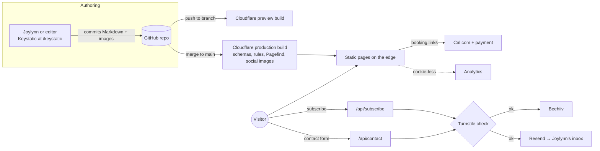

# Build Brief: joylynnwanjiru.com

> **For Claude Code.** This is the single source of truth for building Joylynn Wanjiru's personal site. Read it fully before writing code. Work phase by phase (section 9). Where this brief says **VERIFY**, check the current official docs before implementing, because tool APIs change. Where it says **ASK JOYLYNN**, stop and ask; never invent the answer.

Prepared 26 October 2026.

---

## 0. Working rules for Claude Code

1. **Never invent facts.** No made-up metrics, clients, testimonials, dates, quotes or job titles. Missing content gets a visible placeholder marked `TODO(joylynn): <what is needed>`.
2. **Launch blockers are enforced in code.** A script `pnpm check:launch` fails if any `TODO(joylynn)` remains in a field marked as a launch blocker (section 10). Run it in CI on `main`.
3. **Ask before adding a dependency** that is not listed in section 2.
4. **One task, one branch, one pull request.** Branch names: `feature/…`, `fix/…`, `chore/…`. Keep `main` deployable.
5. **Keep the README true.** It must describe only what is actually in the repo (a gap in the reference repo was a README listing tools that were never installed).
6. **Reference project:** [lewis-kori/astro-portfolio-v3](https://github.com/lewis-kori/astro-portfolio-v3) (MIT). Use it to learn patterns. If any substantial code is copied (for example the Beehiiv form), keep its MIT copyright notice in a `THIRD_PARTY_NOTICES.md` file. Do not copy its content, copy, images or brand colours.
7. **Performance is a requirement, not a polish step.** Every phase ends with the budget in section 7 passing.

---

## 1. Project overview

### Who and why
Joylynn Wanjiru is a Kenyan software engineer (Nairobi, UTC+3) working towards international clients and roles. Her work spans AI systems, backends and full products, with an entrepreneurial side and an interest in photography. The site has two jobs, in this order:

1. **Share the journey.** A home for her writing and a visible record of progress ("one step at a time"), so others a step behind can learn from it.
2. **Prove the work and convert the right visitors.** Case studies that build trust, and a quiet but clear path to hiring her.

Selling must never crowd out sharing. The homepage follows the reference site's order: who she is, her writing, her work, then a single quiet line to "Work with me".

### Positioning
- **Hero line:** I build software people can trust: for public institutions, communities and growing businesses.
- **Signature line (in pink):** One step at a time.
- **The thread through her work:** trust. Wazi cites a source for every answer; HiFadithi verifies each 3D model against the real object; Kadi admits only approved guests.

### Audience
- International clients (small and growing businesses, organisations) checking her credibility, often after a referral or a LinkedIn post.
- Recruiters and collaborators.
- Students and early-career developers reading her writing.

### Success measures (review 90 days after launch)
- Lighthouse 95+ on mobile for every page, all four categories.
- Indexed in Google and Bing; posts appear in search for their topics.
- Newsletter sign-ups, free-call bookings and audit bookings, tracked per button.
- One Steps entry a week and one long post a month published through the editor without touching code.

---

## 2. Stack and costs

| Concern | Choice | Cost | Notes |
| --- | --- | --- | --- |
| Framework | **Astro** (latest stable), TypeScript strict | Free | Static by default |
| Styling | Tailwind CSS 4 mapped to the tokens in section 3 | Free | |
| Hosting | **Cloudflare** (Workers static assets, `@astrojs/cloudflare` adapter) | Free | Static asset requests are free and unlimited; server routes have 100,000 requests a day free |
| Domain | `joylynnwanjiru.com` via Cloudflare Registrar | **$10.46 a year** | The only paid item |
| Content editing | **Keystatic** (GitHub mode in production, local mode in development) | Free | See section 4 |
| Search | **Pagefind** (built at deploy time) | Free | Loaded only when the search box is opened |
| Code blocks | `astro-expressive-code` | Free | Theme to match tokens |
| Images | `astro:assets` with `sharp` at build | Free | AVIF/WebP, explicit sizes |
| Social images | `satori` + `@resvg/resvg-js` at build | Free | One image per post, project and page |
| Fonts | `@fontsource-variable/plus-jakarta-sans`, `@fontsource-variable/inter`, `@fontsource/jetbrains-mono` | Free | Self-hosted, subset to Latin |
| Newsletter | **Beehiiv** ("One Step"), free Launch plan | Free up to 2,500 subscribers | Server-side API call, no Beehiiv script on pages |
| Contact email | **Resend** API | Free tier | VERIFY current free limits |
| Spam protection | **Cloudflare Turnstile** | Free | On contact and newsletter forms |
| Booking | **Cal.com** | Free | Links out; no embed script on page load |
| Audit payment | PayPal app in Cal.com, or a Paystack payment link | Per-transaction fees only | VERIFY which works for a Kenya-based account (section 8) |
| Analytics | Cloudflare Web Analytics + a free event tracker for button clicks | Free | VERIFY event tracker (section 8) |
| Email at domain | Cloudflare Email Routing (hello@ → Gmail) | Free | |
| Indexing | Google Search Console, Bing Webmaster Tools, Cloudflare Crawler Hints (IndexNow) | Free | |

**Do not use Vercel's free Hobby plan for this site.** Its fair-use rules restrict it to non-commercial use, and advertising services counts as commercial.

Package manager: `pnpm`. Node: current LTS.

### 2.1 Architecture at a glance

Everything a visitor reads is built ahead of time and served as static files from Cloudflare's edge. Only three small server routes run on demand, plus the editor route.



**Request flows**

| Flow | Steps | Where it can fail (see 12.4) |
| --- | --- | --- |
| Subscribe | Form → `/api/subscribe` → Turnstile verified → Beehiiv API → success or "already subscribed" | Turnstile fails, Beehiiv down or slow |
| Contact | Form → `/api/contact` → Turnstile verified → validated → Resend email to Joylynn (idempotency key) → BR-1 decides confirmation (call link or Start here) | Resend down, double submit, spam |
| Free call | Qualified confirmation → Cal.com link with booking questions | None on the site |
| Audit | Work with me → Cal.com paid event (or Paystack page → booking link) | Payment without booking (Paystack fallback only) |
| Publish | Keystatic commit → GitHub → build (schemas and rules) → deploy, or failed build keeps the live site | Invalid content fails the build |

**Rendering**

| Route | Rendering |
| --- | --- |
| All pages, `rss.xml`, `sitemap-index.xml`, `robots.txt`, `llms.txt`, social images | Static, built at deploy |
| `/api/subscribe`, `/api/contact` | Server (Cloudflare), on demand |
| `/keystatic` and its API | Server, `noindex` (see section 4 VERIFY) |
| Search | Static index (Pagefind), loaded in the browser on demand |

---

## 3. Design system

### Principles
Minimal, calm, generous white space, one accent per screen. Blue is for action. Pink is the warm spark. No heavy shadows, no gradients except the soft hero glow. It must feel premium to an international client and readable for long posts.

### Colour tokens
Use exactly these. Contrast was checked: all text pairings pass WCAG AA except pink text on white, which is why `--pink-text` exists.

```css
:root{
  --bg:#FFFFFF;
  --soft:#F6F8FC;        /* neutral areas: code blocks, footer, tables */
  --ink:#16213A;
  --muted:#5A6577;
  --line:#E7EAF1;
  --blue:#2B5CE6;        /* primary accent: links, buttons, focus */
  --pink:#E8468D;        /* secondary spark: large type, decoration only */
  --pink-text:#C92F72;   /* pink words at body size (5.08:1 on white) */
  --on-blue:#FFFFFF;     /* text on blue buttons */
  --wash:#FEF4F8;        /* 6% pink into white: hero, newsletter band */
  --tint:#FCE9F1;        /* 12%: pills, tags, badges, card hover */
  --tint-line:#F4D6E3;   /* pink hairline: card borders, pill outlines */
  --glow: radial-gradient(60% 50% at 80% 0%, rgb(232 70 141 / .10), transparent 70%),
          radial-gradient(50% 40% at 0% 100%, rgb(43 92 230 / .06), transparent 70%);
  color-scheme: light;
}
@media (prefers-color-scheme: dark){
  :root:not([data-theme="light"]){
    --bg:#0B1324; --soft:#121B30; --ink:#EAEEF7; --muted:#9AA6BD; --line:#233149;
    --blue:#5B8BFF; --pink:#FF6AA6; --pink-text:#FF6AA6; --on-blue:#0B1324;
    --wash:#1A182C; --tint:#2D1F36; --tint-line:#3A2742;
    --glow: radial-gradient(60% 50% at 80% 0%, rgb(255 106 166 / .14), transparent 70%),
            radial-gradient(50% 40% at 0% 100%, rgb(91 139 255 / .08), transparent 70%);
    color-scheme: dark;
  }
}
:root[data-theme="dark"]{
  --bg:#0B1324; --soft:#121B30; --ink:#EAEEF7; --muted:#9AA6BD; --line:#233149;
  --blue:#5B8BFF; --pink:#FF6AA6; --pink-text:#FF6AA6; --on-blue:#0B1324;
  --wash:#1A182C; --tint:#2D1F36; --tint-line:#3A2742;
  --glow: radial-gradient(60% 50% at 80% 0%, rgb(255 106 166 / .14), transparent 70%),
          radial-gradient(50% 40% at 0% 100%, rgb(91 139 255 / .08), transparent 70%);
  color-scheme: dark;
}
```

Note: on blue buttons in dark mode the text is the dark background colour (`--on-blue`), because white on `#5B8BFF` fails contrast (3.19:1).

### Usage rules
- **Blue:** links, primary buttons, focus rings, active navigation. Never decorative.
- **Pink:** at most one accent per screen: the first letter of a page heading, a highlight underline, the signature line, "new" tags.
- **Wash and glow:** hero (`background: var(--glow), var(--wash)`), newsletter band, Work with me header.
- **Pills/tags:** `background: var(--tint); border: 1px solid var(--tint-line); color: var(--pink-text)`.
- **Cards:** `--bg` surface, `1px solid var(--line)` border, `--tint-line` border on hover. One soft shadow at most.

### Theme switching
- Default follows the system. A toggle sets `data-theme="light|dark"` on `<html>` and saves the choice in `localStorage` (wrapped in try/catch).
- An inline script in `<head>` applies the saved choice before first paint, so there is no flash.
- Two themes only (no sepia).

### Typography
| Role | Font | Notes |
| --- | --- | --- |
| Headings | Plus Jakarta Sans (variable), weights 600–700 | Tight tracking on large sizes |
| Body and UI | Inter (variable), 400 and 500 | |
| Code | JetBrains Mono | |

- Fluid type scale with `clamp()`. Post body 18 px on desktop, 17 px on mobile, line height 1.7, measure 65–72 characters.
- Preload only the two variable files used above the fold. `font-display: swap`, with metric-matched fallbacks to avoid layout shift.

### Layout and motion
- Container max width 72 rem; article column max 42 rem. 16 px side gutters on mobile; no horizontal scroll at 360 px.
- Spacing on a 4 px base.
- Motion: subtle fade/slide on scroll for sections only, disabled under `prefers-reduced-motion`. No animated canvas backgrounds (the reference site's canvas art is skipped to protect performance).

### Accessibility (WCAG 2.2 AA)
Semantic landmarks, one `h1` per page, visible focus rings in `--blue`, skip link, alt text required on every image (enforced by the schema), keyboard-operable menus and theme toggle, form errors announced to screen readers.

---

## 4. Content model and editor

### Approach
Content is Markdown/MDX in the Git repo ("content as code"), validated by Astro content collection schemas, and edited through **Keystatic** at `/keystatic`. Keystatic commits to GitHub, which triggers a deploy. An SEO specialist can edit SEO fields without touching code.

**VERIFY (phase 1 spike, before building pages):** Keystatic's admin route and GitHub mode run on the Cloudflare adapter. If they do not, fall back in this order and tell Joylynn which was used:
1. Keystatic GitHub mode with the admin route served from a separate free deployment.
2. Keystatic Cloud (sign-in with email, no GitHub account needed for editors; VERIFY its free plan limits).
3. Keystatic local mode only (edit locally, push with Git).

Keystatic's collection definitions and Astro's `content.config.ts` schemas must describe the same fields. Keep them side by side and add a test that fails if they drift.

### Editor organisation (Keystatic navigation groups)
- **Writing:** Posts, Steps
- **Work:** Projects, Experience
- **Pages:** Home, About, Now, Start here, Work with me
- **Business:** Services, Testimonials
- **Settings:** Site settings, SEO defaults

### Shared SEO group (on every post, step, project and page)
| Field | Rules |
| --- | --- |
| `seo.title` | Optional, 60 characters max with a live counter; falls back to the title |
| `seo.description` | Required for posts and projects, 155 characters max with a counter |
| `seo.focusKeyword` | Optional; shown as a hint, not used for stuffing |
| `seo.canonical` | Optional URL (for cross-posted pieces) |
| `seo.noindex` | Boolean, default false |
| `seo.ogImage` | Optional; otherwise generated automatically |
| `seo.faq` | Optional list of question/answer pairs |

### Collections

**posts** (`src/content/posts/*.mdx`): title, slug, description, date, updated, tags (from a fixed tag list), series (optional), cover image + alt (alt required if cover set), draft, featured, services (optional multi-select, for linking writing to services), redirectFrom (list of old slugs, filled automatically when a slug changes; see BR-11), seo, body. Steps and projects also get `redirectFrom`.

**steps** (`src/content/steps/*.mdx`): short weekly learning log. title, slug, number (auto-incrementing "Step 1, 2, 3…"), date, tags, summary (one line), draft, seo, body (150–300 words recommended; show a word counter hint).

**projects** (`src/content/projects/*.mdx`): title, slug, kind (`client` | `product` | `programme` | `personal`), oneLiner (max 140 characters), year, role, team (list of name + optional link), context (client, partner or programme), services (multi-select from the services collection), stack (list), outcome (short text; numbers only if provided), links (live, repo, optional; any may be empty), confidential (boolean: hides links and shows "Private project"), cover image + alt, gallery images + alt, featured, order, seo, body sections: Problem, What I built, How it works, Result, What I learned.

**experience** (`src/content/experience/*.md`): organisation, url, role, start, end (or "present"), location / remote, highlights (list), order.

**services** (`src/content/services/*.md`): name, slug, oneLiner, includes (list), buttonLabel, order, faq (list), body (who it's for, how it works).

**testimonials** (`src/content/testimonials/*.md`): quote, name, role, organisation, link (optional), project (reference), permission (boolean; must be true to render).

**pages** (singletons): `home`, `about`, `now`, `start`, `workWithMe`. Each has its own fields listed in section 5.

**site** (singleton, JSON): name, tagline, heroLine, email, location ("Nairobi, Kenya"), timeZone ("EAT, UTC+3"), socials (list), bookingLinks (freeCall, audit), auditPrice, buildFrom, deposit, analytics IDs, search-console verification codes, Beehiiv publication ID reference (the key itself stays in environment secrets).

### Images
Store images under `src/assets/…` so they pass through `astro:assets`. Configure Keystatic image fields so saved images land in `src/assets` and resolve in the Astro schema with the `image()` helper. VERIFY the exact `directory` and `publicPath` settings against current Keystatic + Astro docs. Nothing goes in `public/` except favicons, `robots`-style static files and the manifest.

---

## 5. Pages

### Site map and URLs
| URL | Page |
| --- | --- |
| `/` | Home |
| `/start` | Start here |
| `/writing`, `/writing/page/[n]`, `/writing/tags/[tag]`, `/writing/series/[series]` | Writing index (static pagination and tag pages) |
| `/writing/[slug]` | Post |
| `/steps`, `/steps/[slug]` | Steps log |
| `/work`, `/work/[slug]` | Work index and case studies |
| `/about` | About + Now (anchor `#now`); `/now` redirects to `/about#now` |
| `/work-with-me`, `/work-with-me/[service]` | Services, audit, Kadi, booking |
| `/contact` | Contact form |
| `/rss.xml`, `/sitemap-index.xml`, `/robots.txt`, `/llms.txt` | Feeds and crawler files |
| `/thanks` | Form confirmation for visitors without JavaScript (section 12.4) |
| `/privacy`, `/terms` | Privacy page and audit/deposit terms (section 12.5 and 12.7) |
| `/404` | Not found, with search and links to Start here and Writing |

### Global layout
- **Header:** name (links home), Writing, Steps, Work, About, Work with me (styled as the one blue text link), search button, theme toggle. Mobile: menu button opening an accessible panel.
- **Footer:** short bio line, socials, One Step newsletter form, RSS link, "© year Joylynn Wanjiru", "Built with Astro".
- **No pop-ups.** The newsletter appears inline only.

### Home (in this order)
1. **Hero** (glow + wash background): heading "Hi, I'm Joylynn Wanjiru." · hero line · signature line in pink · two links: "Read my writing" (primary) and "See my work" (secondary) · social icons · portrait (`TODO(joylynn): portrait photo`, launch blocker).
2. **About, in brief:** two to three sentences from the About page, with "More about me →".
3. **Latest writing:** three newest posts plus the three newest Steps entries in a compact list.
4. **Selected work:** three featured projects as cards (cover, title, one-liner, services tags).
5. **Work with me (quiet):** one line: "I help teams with automation and AI, websites and custom software, and growth." with "Work with me →".
6. **One Step newsletter band** (wash background).

### Start here
For first-time visitors: who she is in one paragraph, three best posts (editor-picked), the best case study, the Steps log explained, and two closing links: "Subscribe to One Step" and "Work with me".

### Writing index
Intro: "Writing" heading, one line on what she writes about, newsletter form. Then filter links (tags, series) as real static pages, and a paginated list (9 per page). No client-side filtering of full post data (a gap in the reference repo; see section 7).

### Post page
Breadcrumbs · title · date, updated date, reading time · tags · cover (optional) · table of contents for posts with 3+ headings · body · series navigation · "Subscribe to One Step" box at the end (and one inline prompt after roughly 60% of long posts) · share links (copy link, LinkedIn, X, WhatsApp) · related posts (same tag or series). External links open in a new tab with `rel="noopener noreferrer"`.

### Steps
Index shows entries newest first as "Step 12 · 26 Oct 2026 · title · summary". Entry page is a short post layout with previous/next step navigation.

### Work index
Featured case studies first, then all projects in a grid with a filter by service. Below: **experience timeline** from the experience collection (`TODO(joylynn)` until provided). A "More projects coming" line is fine; empty states never look broken.

### Case study page
Title, one-liner, meta row (year, role, context, stack), cover, then sections Problem → What I built → How it works → Result → What I learned. Team credits with links. Links block (hidden when `confidential` is true, replaced by "Private project: details available on request"). Matching testimonial if one exists. Closing CTA: the related service with its button.

### About + Now
- **About:** long bio, education, timeline, photography note, photo. All `TODO(joylynn)`, **launch blocker**.
- **Now** (`#now`, shows "Last updated <date>"): current focus, what she's building, what she's learning.
- **What I say no to:**
  - Free strategy work before an engagement
  - Projects without a clear decision-maker
  - AI where simple automation would do the job better
- One-page CV download (`TODO(joylynn): cv.pdf`, before launch).

### Work with me
1. **Header** (wash): "How I can help" · "Software and growth for businesses that want results they can trust."
2. **Three service cards** (from the services collection): name, one-liner, includes as small tags, its own button.
3. **Start here: One Step Audit card** (see section 6 copy) with "Book an audit · $77".
4. **"Builds typically start from $500."** and "60% deposit before work starts."
5. **Products: Kadi card** with "Rent Kadi →" (goes to `/contact?topic=kadi`).
6. **Two ways to get in touch:** "Book a free 20-minute call" (goes to the qualifying form) and "Book an audit" (goes to the paid booking). Under them: *Free calls check fit, not solve problems. Best for teams with a budget and a timeline.*
7. Testimonials (render only those with `permission: true`).
8. Short FAQ.

### Service detail pages (`/work-with-me/[service]`)
One-liner · who it's for · what's included · how it works (4 steps: Audit → Plan and quote → Build → Launch and support) · **projects tagged with this service, shown automatically** (if none yet, show the free-call button instead of an empty space) · FAQ · closing filter line · buttons.

### Contact
Form fields: name, email, organisation (optional), topic (Automation & AI · Websites & Custom Software · Growth & Discoverability · One Step Audit · Kadi rental · Something else; preselected from `?topic=`), budget (*Under $500 · $500–1,500 · $1,500–5,000 · $5,000+*), timeline (*This month · Within 3 months · Just exploring*), decision-maker (yes/no), website, message, newsletter opt-in. Turnstile. On success, a clear confirmation; the booking link for the free call is shown only when budget is $500 or more, timeline is not "Just exploring" and they are the decision-maker. Otherwise the confirmation thanks them and points to Start here and the newsletter.

Also show: email address, "Based in Nairobi (EAT, UTC+3): overlaps the full European workday and US East Coast mornings."

---

## 6. Copy to use

### Services
| Service | One line | Includes | Button |
| --- | --- | --- | --- |
| Automation & AI | Repetitive work handled automatically, with a person in control. | Workflow automation · AI agents and chatbots · CRM and WhatsApp integrations | Automate a workflow → |
| Websites & Custom Software | Websites, web apps and payment systems built around how you work. | Websites · web apps and SaaS · booking and payment integrations · APIs and back ends | Start a build → |
| Growth & Discoverability | SEO, content and lead capture that turn attention into enquiries. | Technical SEO · content writing · lead capture | Grow your reach → |

### One Step Audit
> **One Step Audit · $77**
> A clear plan for your next step, before anything is built.
> A short questionnaire, a 60-minute call reviewing your website, tools and workflows, and a written plan within 3 working days: what to fix, what to automate, what to leave alone, and an estimate for each step.
> The fee counts toward any build you start with me within 30 days.

### Kadi (product card)
> **Kadi**: private invitations, QR gate passes and an offline usher scanner for weddings and events. 500 guests, 500 scans, a seamless entry on the day.
> *Hosting an event? Rent Kadi →*

### Case studies (facts only; Joylynn reviews the final wording)

**Kadi: private event invitations and gate passes**
- Kind: client work, now a rentable product. Year: `TODO(joylynn)`.
- What it does: private wedding RSVP platform with couple-approved access, QR gate passes and an offline usher scanner. Built as a multi-tenant system so it can be rented to other clients for a set period.
- Result: 500 guests, 500 scans, seamless entry on the day.
- Stack: Next.js, TypeScript, Postgres, Vercel.
- Client names and guest details are never shown. Screenshots must be blurred.
- Services: Websites & Custom Software.

**HiFadithi: 3D heritage documentation for the National Museums of Kenya**
- One-liner: A web app that turns photos of museum artefacts into verified, narrated 3D records for the National Museums of Kenya.
- What it does: researchers photograph an object from a phone browser; the system builds a textured 3D model in the background using Meshy AI; the researcher checks the model against the real object using measured dimensions and adds the object's story and a recorded narration. Records are versioned, role-based and searchable, replacing slow handwritten catalogue cards.
- Joylynn's role: the 3D model pipeline and the backend.
- Team: four-person team, Software Mahia, through the KamiLimu innovation programme.
- Status: pilot, intended for museums across Kenya. Year: 2026.
- Stack: React, TypeScript, Django REST Framework, Celery, Redis, PostgreSQL, Cloudflare R2, Meshy AI API, `<model-viewer>`, Docker.
- `confidential: true` (no public link).
- Services: Automation & AI, Websites & Custom Software.

**Wazi: public money, in plain language**
- One-liner: An AI tool that answers questions about county budgets and audit findings in English, Swahili or Sheng, with a source citation on every answer.
- What it does: a retrieval-augmented generation pipeline over official county budget and audit documents gives plain-language answers drawn strictly from those documents and never invents figures. Includes a WhatsApp-style chat channel and a community verification signal for disputed project claims.
- Joylynn's role: Backend and AI Engineer. Team: with Chris Waweru Gichohi ([@chriswawerusc](https://github.com/chriswawerusc)), frontend engineer and solutions architect.
- Recognition: finalist, Responsible Computing Buildathon (Mozilla Foundation × KamiLimu), July 2026. Piloted for Nakuru County.
- Stack (from the repo): Python, FastAPI, PostgreSQL with pgvector, fastembed, Anthropic Claude, Twilio (WhatsApp), PyMuPDF, Streamlit admin dashboard, Docker.
- Repo: https://github.com/JoylynnWamjiru/Wazi-
- Services: Automation & AI.

### Microcopy
- Free-call filter line: *Free calls check fit, not solve problems. Best for teams with a budget and a timeline.*
- Newsletter: **One Step** · *What I'm building, learning and figuring out, one step at a time.* Button: "Subscribe". Note: "No spam. Unsubscribe anytime."

---

## 7. SEO, performance and quality

### Built-in SEO (automatic for every page)
- Title, description, canonical, Open Graph and Twitter/X tags from the SEO group, with sensible fallbacks.
- **Generated social image** per post, step, project and page (title, name, pink/blue brand frame), built at deploy time.
- **JSON-LD graph:** `WebSite` + `Person` (name, jobTitle "Software Engineer", address Nairobi KE, `sameAs` links from site settings, `knowsAbout`) on every page; `BlogPosting` on posts and steps; `CreativeWork` on case studies; `Service` (provider: the Person) on service pages; `BreadcrumbList` everywhere below home; `CollectionPage` + `ItemList` on indexes; `FAQPage` where FAQ fields are filled. Note: Google shows FAQ rich results only for some sites; the FAQ still helps readers and AI answers.
- `sitemap-index.xml` excluding drafts and `noindex` pages; `rss.xml` with posts and steps; `robots.txt` allowing search and AI crawlers; `llms.txt` summarising the site and listing recent writing.
- Reading time from body text only (exclude code blocks and frontmatter).
- One shared helper for slugs, used everywhere.
- Build fails if a published post or project is missing a description, or any image is missing alt text.

### Performance budget (checked every phase)
| Measure | Target |
| --- | --- |
| Lighthouse (mobile, every page) | 95+ in all four categories |
| Largest Contentful Paint | under 2.0 s on simulated 4G |
| Cumulative Layout Shift | under 0.05 |
| JavaScript on content pages | under 50 KB (Pagefind loads only on demand) |
| Third-party scripts on first load | none, except deferred analytics |
| Images | AVIF/WebP, responsive `srcset`, explicit width/height |

### Gaps found in the reference repo: do NOT repeat
1. **Serialising every post into the blog index page** (about 310 KB inline). Use static paginated and tag pages.
2. **Large uncompressed screenshots in `public/`** (34 MB). All images go through `astro:assets`.
3. **Server-rendering whole site.** Everything prerenders; only `/api/*` and the editor route run on the server.
4. **A contact form that only opens the visitor's email app.** Ours sends through Resend with Turnstile.
5. **Unused i18n configuration.** None until there is translated content.
6. **One generic social image for most posts.** Generate per page.
7. **Inaccurate reading time and inconsistent slugs.** Shared helpers.
8. **Docs that don't match the code.** README stays accurate.

---

## 8. Integrations

### Newsletter: Beehiiv (One Step)
- Server route `POST /api/subscribe` (adapted from the reference repo's `api/newsletter.ts`, MIT): validates email, verifies Turnstile, calls Beehiiv's subscriptions API with `utm_source=website` and the page path as `utm_campaign`.
- Secrets via `astro:env` server secrets: `BEEHIIV_PUBLICATION_ID`, `BEEHIIV_API_KEY`.
- Forms: footer, Writing index, end of posts, inline prompt in long posts, Start here, home band. Each form passes its location for tracking.

### Contact: Resend + Turnstile
- `POST /api/contact`: validate fields, verify Turnstile server-side, send a formatted email to the site email via Resend, optional Beehiiv opt-in, return JSON. Rate-limit by IP.
- Secrets: `RESEND_API_KEY`, `TURNSTILE_SECRET_KEY`; public `TURNSTILE_SITE_KEY`.

### Booking: Cal.com
- Two event types: **Free 20-minute fit call** (required booking questions mirroring the contact form) and **One Step Audit, $77, paid at booking**.
- Links only (no embed on page load). Links carry `?utm_source=site&utm_content=<button>`.
- **VERIFY:** whether Cal.com's PayPal app can take payment for a Kenya-based account on the free plan. If not, the audit button goes to a Paystack payment page and the booking link is sent on the payment confirmation page. Ask Joylynn which accounts she has.

### Analytics
- Cloudflare Web Analytics for traffic (no cookies).
- Button-level events (`newsletter_subscribe`, `free_call_click`, `audit_click`, `contact_submit`, `kadi_click`, per-service button clicks). Cloudflare Web Analytics does not record custom events: **VERIFY** a free, cookie-less tracker that allows commercial sites (for example Umami Cloud's free tier) and confirm with Joylynn before adding it.

### Indexing
After first deploy: verify Google Search Console and Bing Webmaster Tools, submit the sitemap, enable Cloudflare Crawler Hints (IndexNow).

---

## 9. Phased build plan

Each phase ends with its **definition of done** passing and a preview deployment Joylynn can open.

### Phase 1: Foundation
- Astro project, TypeScript strict, Tailwind 4 with tokens, fonts, base layout, header/footer, theme toggle with no flash.
- `SEOHead` component (meta, OG, JSON-LD graph), social image generator, sitemap, RSS, robots, `llms.txt`, 404.
- Content collections and schemas (section 4), shared helpers (slug, reading time, dates).
- **Keystatic spike** (section 4 VERIFY) and editor navigation groups.
- `pnpm check:launch` script and CI (build, type check, lint, link check, Lighthouse CI on preview).
- Build-time rules from section 12.3 (BR-5, BR-6, BR-7, BR-9, BR-10, BR-11, BR-13), the published-URL manifest, redirects and security headers (section 12.5).
- Placeholder content for everything marked `TODO(joylynn)`.
- **Done when:** a sample post edited in Keystatic deploys to a Cloudflare preview; Lighthouse 95+; both themes pass contrast checks.

### Phase 2: Pages
- **Visual reference:** follow the approved Home and case study mockups (Joylynn will add exports of them to `docs/design/`). Every other page reuses their header, footer, type scale, cards, pills and spacing. **ASK JOYLYNN** for the exports if they are not in the repo.
- Home, Start here, Writing (index, pagination, tags, series, post page), Steps, Work (index, timeline, case study template), About + Now, Work with me, service pages, Contact (UI only).
- Enter the three case studies from section 6.
- **ASK JOYLYNN for screenshots now:** Kadi (blurred names and faces), HiFadithi (no confidential data), Wazi. Until they arrive, use neutral branded placeholder covers.
- **Done when:** every page renders in both themes at 360 px, 768 px and 1280 px with no horizontal scroll; all placeholders are visible and listed by `pnpm check:launch`.

### Phase 3: Integrations
- Beehiiv subscribe, contact form (Resend + Turnstile), Cal.com links and booking questions, audit payment path, Pagefind search, analytics and button events.
- **ASK JOYLYNN** to create: Beehiiv publication "One Step", Resend account, Cloudflare Turnstile site, Cal.com account with both event types, payment account (PayPal or Paystack).
- Form rules BR-1, BR-2, BR-12 and every form-related edge case in section 12.4, with automated tests.
- **Done when:** a test subscription, a test contact message and both booking paths work end to end on a preview, and simulated failures (Beehiiv down, Resend down, double submit, no JavaScript) behave as section 12.4 says.

### Phase 4: Content and launch
- **ASK JOYLYNN for launch blockers:** About section (short and long bio, education, timeline, photography note), portrait photo, social links, contact email. Before launch too: two testimonials (with permission), one-page CV, first two posts (suggested: "How I built Wazi so it never invents a number" and Step 1), fix the placeholder clone instructions in the Wazi README, and her conversation with Lewis Kori about discovery and pricing.
- Buy `joylynnwanjiru.com` on Cloudflare, connect it, set up Email Routing (hello@).
- Privacy and terms pages, with Joylynn's answers to section 12.7.
- Final accessibility pass, Lighthouse on every page, broken-link check, `pnpm check:launch` clean.
- Deploy to production, verify Search Console and Bing, submit sitemap, enable Crawler Hints.
- **Done when:** the site is live on the domain with no `TODO(joylynn)` left in launch-blocking fields.

### Phase 5 (after launch): Grow
- Topic clusters (a hub page per theme linking all related posts).
- Cross-posting workflow to dev.to/Hashnode/Medium with canonical links back.
- "For those starting out" page: resources, KamiLimu experience, what she wishes she'd known.
- More projects (Joylynn will add them through the editor).
- Monthly support retainer offer, once there are repeat clients.
- 90-day review of analytics: sharpen or drop services and buttons nobody uses; consider raising the audit price after the first five clients.

### Phase 6 (later): Photography
- Photo journal and photostream modelled on the reference site's `photoJournals` collection (place, dates, camera, lens, captions), with `noindex` and `draft` flags.

---

## 10. Joylynn's inputs checklist

| Item | Needed by | Launch blocker? |
| --- | --- | --- |
| Screenshots: Kadi (blurred), HiFadithi, Wazi | Phase 2 | No (placeholders allowed) |
| Kadi year built | Phase 2 | No |
| Accounts: Beehiiv, Resend, Turnstile, Cal.com, PayPal or Paystack | Phase 3 | Yes |
| About: short bio, long bio, education, timeline | Phase 4 | **Yes** |
| Portrait photo | Phase 4 | **Yes** |
| Social links and contact email | Phase 4 | **Yes** |
| Two testimonials with permission | Phase 4 | No |
| One-page CV (PDF) | Phase 4 | No |
| First two posts | Phase 4 | **Yes** (at least one) |
| Domain purchase and Cloudflare account | Phase 4 | **Yes** |
| Wazi README clone instructions fixed | Before launch | No |
| Conversation with Lewis Kori on discovery and pricing | Before launch | No |
| Experience timeline entries | Phase 4 | No |

---

## 11. Decisions already made (do not reopen without Joylynn)

- Name: Joylynn Wanjiru · GitHub: [JoylynnWamjiru](https://github.com/JoylynnWamjiru)
- Hosting: Cloudflare (not Vercel Hobby) · Domain: joylynnwanjiru.com
- Editor: Keystatic · Newsletter: Beehiiv, "One Step"
- Fonts: Plus Jakarta Sans, Inter, JetBrains Mono · Two themes
- Homepage order: hero, about, writing and Steps, work, quiet "Work with me" line, newsletter
- Steps is in version 1
- Services: Automation & AI · Websites & Custom Software · Growth & Discoverability
- One Step Audit: $77, paid at booking, credited toward a build within 30 days
- Builds from $500 · 60% deposit before work starts
- Free 20-minute call for fit only, behind a qualifying form
- Kadi is a rentable product and gets its own card
- Photography comes later; i18n is not used

---

## 12. Behaviour spec

This section defines how the site must behave, including when things go wrong. Rules are numbered so they can be tested; every rule in 12.3 needs at least one automated test.

**Project type:** a content site (writing, case studies, pages) with a thin transactional layer (newsletter, contact form, bookings, audit payment). The content model and performance are central; the transactional parts are small but must never lose a message or take money without a booking.

### 12.1 Who uses the site

| Actor | Can | Cannot |
| --- | --- | --- |
| Visitor | Read everything published, search, switch theme, share, subscribe, submit the contact form, follow booking links | See drafts, previews or the editor |
| Subscriber | Receive One Step by email; unsubscribe from any email (handled by Beehiiv) | |
| Prospective client | Everything a visitor can, plus book the free call (if qualified) or pay for and book the audit | Book a free call without passing the qualifying rule (BR-1) |
| Joylynn (owner) | Edit all content and settings in Keystatic, publish, manage accounts, grant and remove editor access | |
| Content or SEO editor | Edit content and SEO fields through Keystatic | Change settings, prices or code without Joylynn's approval (see 12.5) |

### 12.2 Lifecycles

**Content: from draft to live**

```
Draft ──save──▶ Preview ──publish (draft: false, merged to main)──▶ Live ──edit──▶ Live (updated date set)
                                                                   └──unpublish or slug change──▶ Redirected
```

| Step | Triggered by | What is recorded |
| --- | --- | --- |
| Draft | Editor creates an entry (`draft: true` by default) | Git commit with author |
| Preview | Each commit on a branch builds a Cloudflare preview | Preview URL |
| Live | Editor sets `draft: false` and the change reaches `main` | Publish date; entry added to the published-URL manifest (BR-11) |
| Updated | Editor changes a live entry | `updated` date shown on the page and in structured data |
| Redirected | Slug changed or entry removed | Old URL added to `redirectFrom`; 301 redirect generated |

**Enquiry: from first contact to paid work**

Only the first three steps happen on the site; the rest are tracked by Joylynn outside it (a spreadsheet is enough at launch).

```
Enquiry submitted ─┬─▶ Qualified ──▶ Free call booked ──▶ Call held ─┬─▶ Audit paid and booked ──▶ Plan delivered (≤3 working days) ──▶ Quote sent ─┬─▶ 60% deposit paid ──▶ Build ──▶ Delivered
                   │                                                  └─▶ Not a fit (closed)                                              └─▶ Declined (closed)
                   └─▶ Redirected (newsletter and Start here, no call link)
Audit paid directly from Work with me ──▶ Audit booked ──▶ Plan delivered ──▶ …
Audit credit: valid 30 days from plan delivery; after that the full build price applies.
```

| Step | Triggered by | What is captured |
| --- | --- | --- |
| Enquiry submitted | Visitor submits the contact form | Email to Joylynn with every form field |
| Qualified or redirected | The site, automatically, by BR-1 | Which confirmation the visitor saw (analytics event) |
| Free call booked | Visitor, through Cal.com | Cal.com booking with the required answers |
| Audit paid and booked | Client, through the payment path (section 8) | Payment receipt and booking |
| Plan, quote, deposit, build | Joylynn | Outside the site |

### 12.3 Business rules

| ID | Rule |
| --- | --- |
| BR-1 | The free-call booking link is shown only when budget is $500 or more **and** timeline is not "Just exploring" **and** the person is the decision-maker. Otherwise the confirmation thanks them and links to Start here and the newsletter. |
| BR-2 | Enquiries with topic "Kadi rental" skip BR-1: the confirmation says Joylynn will reply by email, and no call link is shown. |
| BR-3 | A testimonial renders only when `permission: true`. Setting it to false removes it on the next deploy. |
| BR-4 | When a project is `confidential: true`, its links are never rendered, even if filled in; the build prints a warning if links exist on a confidential project. |
| BR-5 | Drafts never appear on production pages, in the sitemap, RSS, search index, `llms.txt` or related-post lists. |
| BR-6 | `noindex` pages carry a robots `noindex` tag and are left out of the sitemap, search index and `llms.txt`. |
| BR-7 | Audit price, build-from price and deposit percentage are read only from site settings. No price is hard-coded anywhere; a test fails if `$77`, `$500` or `60%` appears in a component or page file. |
| BR-8 | The 30-day audit credit is stated in the copy and applied manually by Joylynn (not automated). |
| BR-9 | Steps numbers are unique and sequential; the build fails on a duplicate or a gap. |
| BR-10 | A published post, step or project must have a description, and every image must have alt text, or the build fails. |
| BR-11 | Every URL that has ever been published stays reachable. A committed manifest lists published URLs; CI fails if a URL disappears without a redirect. |
| BR-12 | No form is processed until its Turnstile token is verified on the server. |
| BR-13 | The SEO description is cut off at 155 characters and the SEO title at 60 in the editor; social images truncate long titles to three lines with an ellipsis. |

### 12.4 Edge cases

| Scenario | Correct behaviour |
| --- | --- |
| Beehiiv is down or slow | Time out after 8 seconds; show "Couldn't subscribe just now. Please try again, or email me." Never show success unless Beehiiv confirms. Log the failure without the email address. |
| Visitor is already subscribed | Show "You're already on the list", not an error. |
| Resend is down when the contact form is sent | Retry once; if it still fails, show an error that keeps everything the visitor typed and offers a prefilled email link to the site address, so no message is lost. |
| Form submitted twice (double click, slow network) | Button disabled while sending; the API sends an idempotency key with the email request so the same submission is delivered once. VERIFY Resend's idempotency support. |
| Bot or spam flood | Turnstile (BR-12), a hidden honeypot field, length limits (message 5,000 characters), and a Cloudflare rate-limiting rule on `/api/*`. VERIFY what the free plan allows. |
| JavaScript disabled or failed | Forms still work: they are real HTML forms posting to the API, which redirects to a `/thanks` page. Search falls back to a link to `/writing`. |
| Visitor pays for the audit but the booking step fails | With Cal.com payments, payment and booking are one step, so this cannot happen. With the Paystack fallback, the booking link is shown on the payment success page and also emailed; Joylynn matches payments to bookings. |
| Someone books the audit without paying (Paystack fallback only) | The booking page states that unpaid bookings are cancelled; Joylynn cancels within 24 hours and sends the payment link. |
| Client misses or cancels the audit | Follow the audit terms (ASK JOYLYNN, 12.7). |
| Visitor is in another time zone | Cal.com shows times in the visitor's zone; the site states "Nairobi, EAT (UTC+3)". |
| An editor's change breaks the build | The live site keeps the last successful deployment; Joylynn gets the failed-build email from Cloudflare and GitHub; the editor sees the error in the pull request. |
| Slug changed or post removed | Old URL redirects (301) to the new one, or to `/writing` if removed (BR-11). |
| Social image generation fails for one entry | Use the default site social image; the build continues and prints a warning. |
| A confidential project gets a public link by mistake | Not rendered (BR-4); build warning. |
| Unblurred Kadi screenshots are added | Not allowed: Kadi images must be the blurred versions Joylynn supplies; until then, placeholders. |
| Very large image uploaded from a phone | The build resizes it; CI warns about source images over 5 MB so the repo stays small. |
| Browser blocks `localStorage` | Theme follows the system setting; no errors. |
| External links break over time | A scheduled monthly link check opens an issue listing broken links. |
| A price or booking link changes | One edit in site settings updates every page (BR-7). |
| Newsletter nears Beehiiv's 2,500 free limit | Joylynn decides whether to upgrade or move; switching provider only changes `/api/subscribe`. |

### 12.5 Security and privacy

- **Secrets** live only in Cloudflare environment variables (typed through `astro:env`); `.env.example` lists names, never values.
- **Editor access:** editors are GitHub collaborators with two-factor authentication required. `main` is protected; changes from anyone but Joylynn arrive as pull requests she approves. VERIFY that Keystatic's GitHub mode works with branch protection (it supports editing on branches). Removing access means removing the collaborator.
- The `/keystatic` route is `noindex` and disallowed in `robots.txt`.
- **Personal data:** the site stores no personal data itself. Contact messages go only to Joylynn's inbox; subscribers live in Beehiiv; bookings in Cal.com; payments with the payment provider. Server logs never contain email addresses or message text.
- **Privacy page** (`/privacy`, linked in the footer): what is collected, by which service, why, how long it is kept, and how to ask for deletion. It matters for visitors in Europe and under Kenya's Data Protection Act. Joylynn should have it reviewed; this brief is not legal advice.
- **Security headers:** Content-Security-Policy (allowing only Turnstile and the chosen analytics), Strict-Transport-Security, X-Content-Type-Options, Referrer-Policy and Permissions-Policy.
- **Input handling:** all form input validated on the server with Zod, length-limited and escaped before it goes into an email.
- **Dependencies:** Dependabot on, with weekly updates.

### 12.6 Non-goals

- No user accounts, logins for visitors, comments or likes.
- No online shop or payment handling inside the site; payment goes through Cal.com, PayPal or Paystack.
- No CRM inside the site; enquiries are tracked by Joylynn outside it.
- No translated versions (no i18n).
- No pop-ups, chat widgets or advertising.
- No photography section until Phase 6.

### 12.7 Assumptions to confirm (ASK JOYLYNN)

| Assumption | Default until confirmed |
| --- | --- |
| Audit no-show and cancellation policy | One free reschedule with 24 hours' notice; no refund for a no-show |
| Prices shown in USD only | Show "USD" next to every price; no KES conversion |
| Kadi rental pricing | Not shown; "Rent Kadi" leads to an email reply |
| SEO specialist edits through pull requests | Yes, Joylynn approves before publishing |
| Short terms page for the audit and deposit | Add `/terms` alongside `/privacy` |

---

## 13. Sources
- Reference site and code: [lewiskori.com](https://lewiskori.com/), [lewis-kori/astro-portfolio-v3](https://github.com/lewis-kori/astro-portfolio-v3)
- Benchmark for services: [Inflection Studio](https://inflectionstudio.io/)
- [Vercel fair use guidelines (commercial usage)](https://vercel.com/docs/limits/fair-use-guidelines)
- [Cloudflare Workers pricing](https://developers.cloudflare.com/workers/platform/pricing/)
- [Cloudflare domain pricing, October 2026 (CostGoat)](https://costgoat.com/pricing/cloudflare-domains)
- [Keystatic with Astro (Astro docs)](https://docs.astro.build/en/guides/cms/keystatic/)
- [beehiiv pricing 2026 (DailyAIFixs)](https://dailyaifixs.com/blog/beehiiv-pricing-2026-the-2-500-subscriber-cliff)
- [Wazi repository](https://github.com/JoylynnWamjiru/Wazi-)
